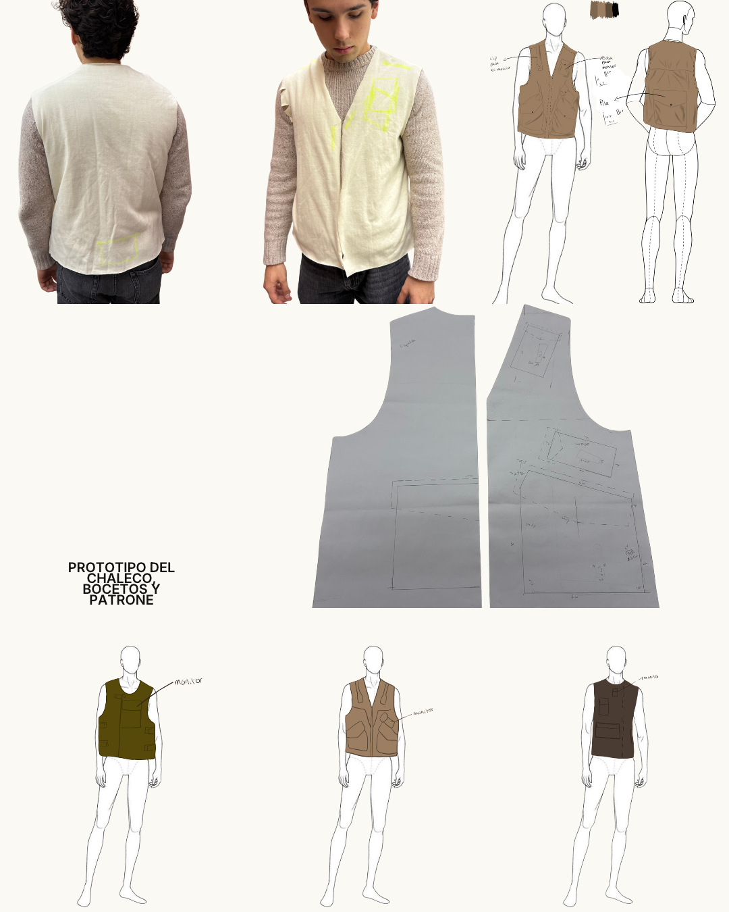

# Diseño de la prenda — prototipo, bocetos y patrón

Tercera actualización de la página web. Responsable: **Paola Morales**.

---

## 1. Prototipo en tela cruda

- Chaleco de escote en V y frente abierto, montado en manta para **validar volumen y caída antes de cortar la tela definitiva**.
- Las **marcas amarillas** señalan la ubicación prevista de los módulos electrónicos sobre el cuerpo.
- Probado sobre un usuario real para verificar holgura y libertad de movimiento de brazos.

---

## 2. Ficha técnica

Vistas de frente y espalda con:

- Bolsas de parche integradas al cuerpo de la prenda
- Alojamientos señalados para el módulo de sensado, la batería y el indicador
- Referencias de posición sobre la figura, no sobre la prenda ya cosida

---

## 3. Patrón

Piezas de delantero y espalda trazadas en papel.

Lo relevante: **los alojamientos están dibujados dentro del patrón**, no agregados sobre una prenda terminada. La electrónica forma parte de la construcción de la prenda desde el corte.

---

## 4. Propuestas de color

Tres variantes sobre la misma base —olivo, camel y café oscuro— con la posición del monitor señalada en cada una. La paleta se eligió dentro del rango cromático de la ropa de trabajo.

---

## 5. Decisiones de diseño y su origen

| Decisión | Insight que la sustenta |
|---|---|
| Formato chaleco, no dispositivo colgante o de muñeca | **I4** — el trabajador adopta lo que se funde con su equipo |
| Indicador al frente, visible para el usuario y para terceros | **I2** — solo se protegen cuando ven el riesgo |
| Alojamientos trazados en el patrón, sin elementos que cuelguen | **I4** — lo que estorba o se engancha se abandona |
| Paleta dentro del rango de la ropa de trabajo | **I4** — integrarse al equipo, no destacar como un aparato |

---

## 6. Pendientes de esta etapa

- [ ] Definir tela definitiva y verificar su resistencia al uso en exterior
- [ ] Resolver módulos **desmontables** para permitir el lavado de la prenda
- [ ] Definir tipo de cierre del frente
- [ ] Ajustar la posición final de los alojamientos con las medidas reales de las carcasas 3D
- [ ] Definir rango de tallas

---

## Siguiente sección
[Cronograma y rol de participación](05-03-cronograma.md)
